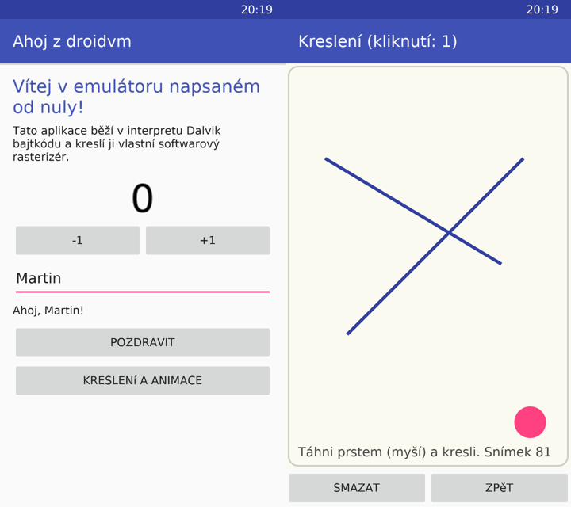

# droidvm – Android emulátor napsaný od nuly

`droidvm` spouští jednoduché Android aplikace (APK) na desktopu, bez Androidu, bez QEMU a bez cizího kódu z AOSP. Všechno je napsané od nuly v C++17, zhruba 5 500 řádků (bez vygenerovaného fontu):

- čtení APK (ZIP), binárního `AndroidManifest.xml` a `classes.dex`,
- **interpret Dalvik bajtkódu** (všechny běžné instrukce, výjimky, virtuální volání, rozhraní, statické inicializátory, garbage collector),
- vlastní implementace části `java.lang` / `java.util` (String, StringBuilder, ArrayList, HashMap, Random, Math, výjimky…),
- vlastní **Android framework**: Activity (i víc aktivit a Intent), View, ViewGroup, LinearLayout, FrameLayout, ScrollView, TextView, Button, EditText, Canvas, Paint, Color, Handler, Toast, Log,
- **softwarový rasterizér** s vyhlazováním (obdélníky, kruhy, ovály, čáry, text s diakritikou),
- okno přes SDL2 (myš = prst, klávesnice pro EditText, Esc = tlačítko Zpět).

Je to **učební projekt**. Průvodce kódem najdeš v [docs/navod.md](docs/navod.md) a cvičení v [docs/cviceni.md](docs/cviceni.md).



## Sestavení na FreeBSD

```sh
pkg install cmake sdl2
cmake -S . -B build -DCMAKE_BUILD_TYPE=Release
cmake --build build -j
ctest --test-dir build        # 3 testy: interpret vs. JVM a dva testy UI
```

Na Linuxu stačí `apt install cmake libsdl2-dev zlib1g-dev`.

## Spuštění

```sh
./build/droidvm tests/data/ahoj.apk                 # okno s ukázkovou aplikací
./build/droidvm tests/data/vmtest.dex --main VmTest # konzolový program (main)
./build/droidvm app.apk --headless --run 2000 --tap 540,600@500 --screenshot out.bmp
```

Volby: `--activity` (spustit jinou aktivitu), `--scale 0.75` (velikost okna), `--trace` (vypisuje každou instrukci) a pro běh bez okna `--headless`, `--run`, `--tap`, `--swipe`, `--type` a `--screenshot`.

## Vlastní aplikace

Aplikaci napíšeš v Javě (UI skládej v kódu, viz `samples/ahoj`) a sestavíš ji bez Android SDK:

```sh
pkg install openjdk17 python3 zip
fetch https://repo1.maven.org/maven2/com/jakewharton/android/repackaged/dalvik-dx/9.0.0_r3/dalvik-dx-9.0.0_r3.jar
DX_JAR=$PWD/dalvik-dx-9.0.0_r3.jar samples/build-apk.sh samples/ahoj cz.priklad.ahoj MainActivity Ahoj DrawActivity
./build/droidvm samples/ahoj/build/ahoj.apk
```

## Co (zatím) nejde

droidvm umí jen zlomek Androidu. Skutečné aplikace z Google Play používají XML layouty a zdroje (`resources.arsc`), obrázky, AndroidX, vlákna, síť a nativní knihovny (`.so`), takže je nespustí. Na ty slouží [bsdroid](../bsdroid) (plný Android v bhyve). Nepodporované třídy a metody se nahradí prázdnými stuby a vypíše se varování `[droidvm] ... not implemented`. Podle něj poznáš, co doprogramovat dál.

Další omezení:

- lambdy z Javy 8 (invokedynamic): dx je neumí, používej anonymní třídy,
- `String.split` bere oddělovač doslova (nejde o regulární výraz),
- vše běží v jednom vlákně.

## Licence fontu

`src/gfx/font_data.h` je vygenerovaný z fontu DejaVu Sans (volná licence Bitstream Vera / DejaVu, https://dejavu-fonts.github.io/License.html) skriptem `tools/genfont.py`.
